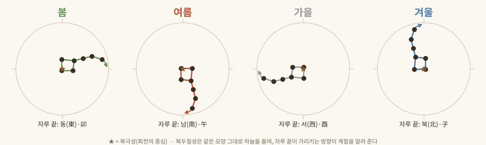
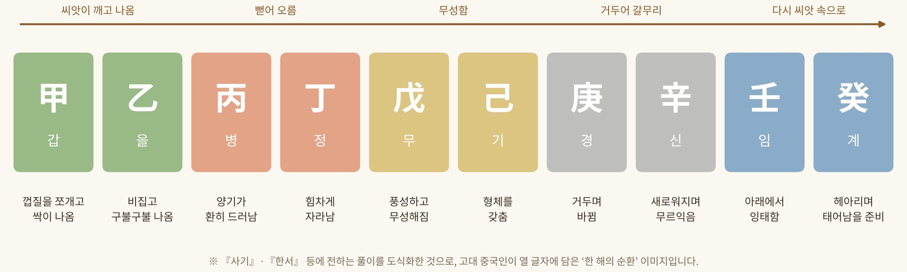
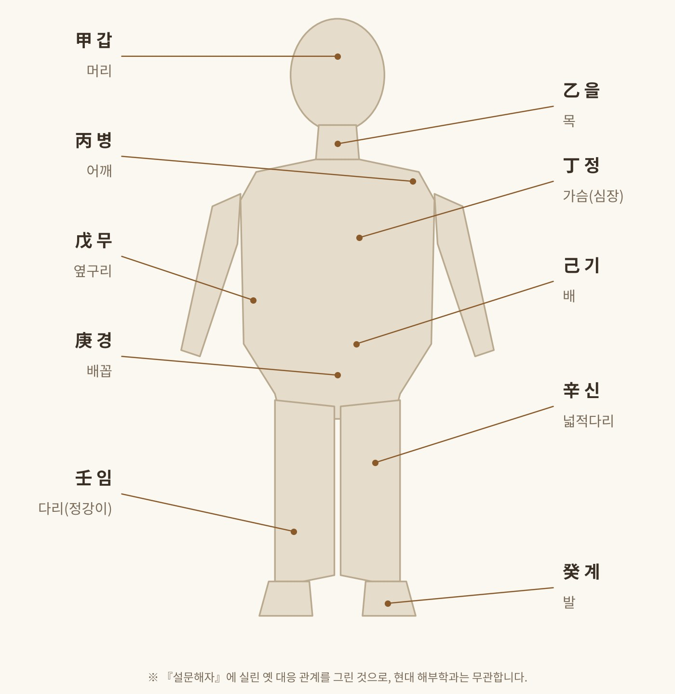

*별과 손가락, 갑골에서 몸의 부위까지*

## 줄기와 가지, 간지(干支)

사주의 여덟 글자는 천간(天干)과 지지(地支)로 이뤄진다. 간(干)은 나무의 줄기(幹)에서, 지(支)는 나뭇가지(枝)에서 온 글자다. 영어로는 각각 '하늘의 줄기(heavenly stems)', '땅의 가지(earthly branches)'라 옮긴다. 『삼명통회』는 줄기는 강하니 양, 가지는 약하니 음이라 풀었고, 후한 때의 『백호통』에도 '갑을은 간이고 자축은 지'라는 구절이 보인다.

이 글자를 누가 만들었는지는 분명치 않다. 약 4,600년 전 황제 시대의 대요(大撓)가 만들었다는 설, 천황씨가 세상을 다스리며 이름을 붙였다는 설, 복희씨가 갑력(甲曆)을 만들었다는 설이 전해진다. 모두 전설 속 인물이라 역사적으로 확인하기 어렵다. 다만 상(商)나라 때는 이미 널리 쓰였다는 점은 같다. 대요설을 전하는 기록은 북두칠성이 서 있는 방향을 살펴 갑을을 만들어 해(日)의 이름으로, 자축을 만들어 달(月)의 이름으로 삼았고, 둘을 맞춰 60일의 주기를 이뤘다고 적는다. 그래서 천간은 하늘의 일, 지지는 땅의 일을 가리킨다고도 한다.

## 별을 보고 만든 달력

간지는 하늘을 관찰한 데서 나왔다는 설명이 많다. 북두칠성의 자루는 봄에 동쪽, 여름에 남쪽, 가을에 서쪽, 겨울에 북쪽을 가리킨다. 그 방향이 해당 달의 지지에 해당한다고 보아 계절과 달을 읽는 시계로 삼았다. 목성은 태양을 한 바퀴 도는 데 11.86년, 약 12년이 걸린다. 하늘을 12구간으로 나누고 목성이 해마다 한 구간씩 지나는 것을 12지지에 배정했으며, 그래서 목성을 세성(歲星)이라 불렀다.

*그림 1. 북두칠성 자루 끝이 가리키는 방향과 계절 (개념도)*

여기에 열 손가락으로 날을 세던 십진법이 더해진다. 열흘을 한 순(旬)으로 삼아 상순·중순·하순, 곧 한 달 30일을 헤아렸다. 이 열흘의 주기가 10천간이고 1년 12개월의 주기가 12지지이며, 앞의 것을 양, 뒤의 것을 음으로 본다. 첫 천간 갑(甲)과 첫 지지 자(子)가 만난 갑자(甲子)가 육십갑자의 시작이다.

## 갑골에 새긴 날짜와 질문

상나라 사람들은 나랏일을 거북 껍질로 점쳤고, 그 내용을 새긴 것이 갑골문이다. 점친 날짜는 간지로 적었고, 왕의 이름에는 반드시 천간 글자 하나를 썼다. '오늘 비가 올까요(貞 今日 其 雨)'처럼 날씨를 묻는 소박한 질문도 남아 있다. 점사의 내용을 분류한 집계를 보면 전쟁이 93건으로 가장 많고, 홍수·가뭄과 풍흉이 45건, 왕조의 흥망이 23건이다. 질병에 관한 점사는 5건에 불과하다. 초기의 점이 일반 백성의 일상보다 통치자의 수단이었음을 짐작하게 한다. 갑골문 속 간지의 모양은 오늘날과 많이 달라서, 무(戊)와 기(己)는 거의 구별하기 어려울 만큼 닮았다.

## 열 글자에 담긴 한살이

『사기』와 『한서』는 열 천간을 식물이 싹터 자라고 열매 맺어 다시 씨앗을 품는 과정으로 풀었다. 갑(甲)은 껍질을 쪼개고 나오는 것이고, 을(乙)은 비집고 구불구불 나오는 것이다. 병(丙)은 양기가 환히 드러나는 것, 정(丁)은 장성하는 것, 무(戊)는 풍성하고 무성한 것, 기(己)는 형체를 갖추는 것이다. 경(庚)은 거두며 바뀌는 것, 신(辛)은 새로워지며 성숙하는 것, 임(壬)은 아래에서 잉태하는 것, 계(癸)는 헤아려 태어남을 준비하는 것이다. 열 글자가 한 해의 순환이자 생명의 한살이를 이루는 셈이다.

*그림 2. 열 천간에 담긴 '한 해의 순환' 이미지 (개념도)*

『설문해자』는 여기에 몸을 겹쳐 놓았다. 갑은 머리, 을은 목, 병은 어깨, 정은 심장, 무는 옆구리, 기는 배, 경은 배꼽, 신은 넓적다리, 임은 다리, 계는 발이다. 머리에서 발까지 열 글자가 몸을 따라 내려온다. 앞서 본 인부천수처럼 몸을 자연의 질서에 맞춰 읽던 방식이며, 상징적 대응일 뿐 해부학적 설명은 아니다.

*그림 3. 『설문해자』가 열 천간에 겹쳐 놓은 몸의 부위 (개념도)*

이후 열 글자는 물상(物象)과 오행으로 구체화된다. 갑은 큰 나무, 을은 풀과 꽃, 병은 태양, 정은 등불, 무는 산, 기는 논밭, 경은 바위와 쇠, 신은 보석과 바늘, 임은 바다와 큰 강, 계는 샘과 이슬에 비유한다. 여기에 목은 성장과 인자함, 화는 열정, 토는 신중함, 금은 결단력, 수는 유연함이라는 성향이 따라붙는다. 다만 이는 사람을 다섯 유형으로 나누는 전통적 틀일 뿐, 개인의 성격이나 건강을 확정하는 근거가 되지는 않는다.

## 다음 회에는

다음 회에서는 열두 개의 땅의 글자, 지지(地支)를 살펴본다.
