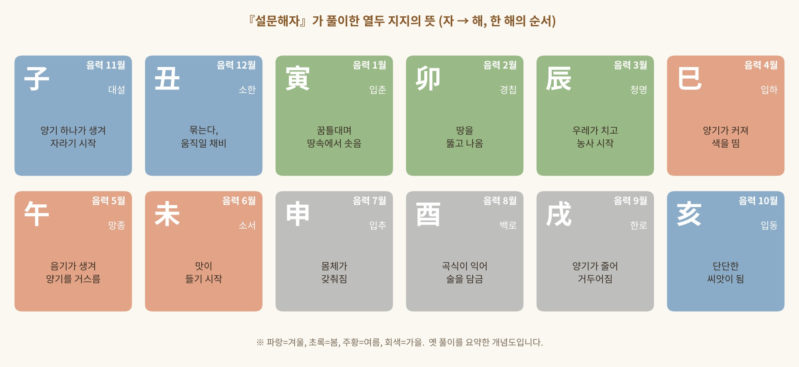
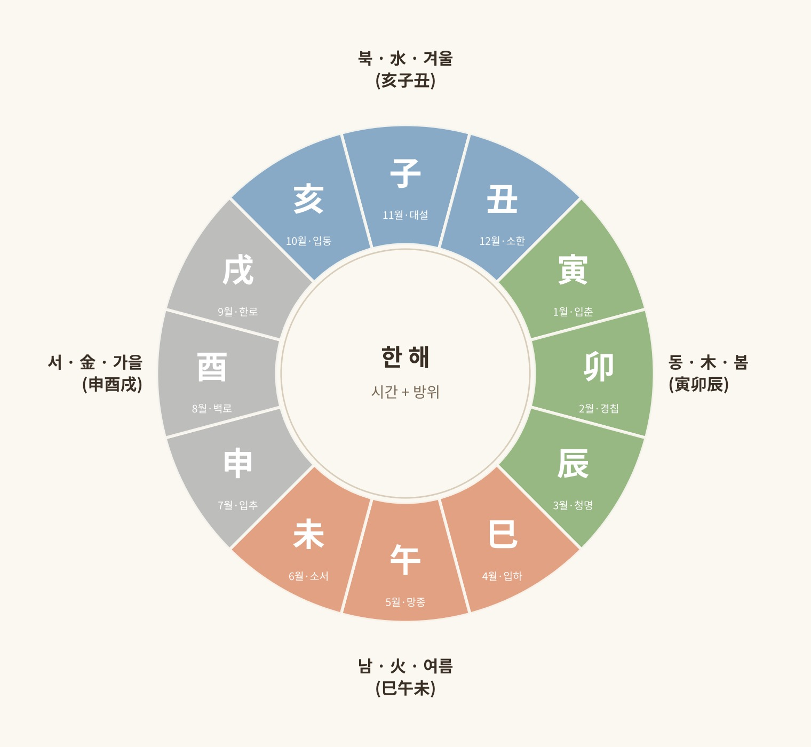

한 해의 달력이자 방위의 지도

## 하늘은 열, 땅은 열둘

지난 회에 열 개의 천간을 살폈다. 사주를 이루는 나머지 절반은 열두 개의 글자, 지지(地支)다. 자(子)·축(丑)·인(寅)·묘(卯)·진(辰)·사(巳)·오(午)·미(未)·신(申)·유(酉)·술(戌)·해(亥). 쥐, 소, 호랑이, 토끼로 시작하는 '띠'로 익숙한 바로 그 열두 글자다. 명리학 고전 『삼명통회』는 천간을 나무 줄기처럼 강한 것이라 양(陽), 지지를 가지처럼 약한 것이라 음(陰)으로 풀이한다. 하늘의 기운이 줄기라면, 그것이 땅으로 내려와 계절과 방위 속에 자리 잡은 모습이 가지라는 뜻이다.

기원에 관한 이야기는 신화에 가깝다. 『연해자평』은 중국 전설 속 황제(黃帝)가 제사를 올리자 하늘이 천간과 십이지를 내려 주었고, 신하 대요가 이를 짝지어 육십갑자를 완성했다고 전한다. 『삼명통회』에는 천황씨·지황씨·인황씨가 각각 자(子)·축(丑)·인(寅)에서 하늘과 땅과 사람이 열렸다고 보았다는 대목이 있다. 한 해의 시작을 자월, 축월, 인월 중 어디에 둘 것이냐를 두고 역법마다 달랐다는 '삼역설'도 함께 소개된다. 모두 전해 오는 설명일 뿐, 역사적 사실로 확인된 것은 아니다.

## 글자 하나에 담긴 한 해

후한의 자전 『설문해자』는 열두 글자를 달력의 달에 맞춰 풀이한다. 자는 음력 11월에 양기 하나가 생겨 만물이 자라기 시작한다는 뜻이다. 축은 '묶는다'는 뜻으로 12월에 만물이 움직일 채비를 한다. 인은 '꿈틀댄다'이며 정월에 양기가 땅속에서 솟는다. 묘는 2월에 만물이 땅을 뚫고 나온다는 뜻이고, 진은 3월에 우레가 치며 농사가 시작된다는 뜻이다. 사는 4월에 양기가 커져 만물이 색을 띤다는 뜻이다. 오는 5월에 음기가 처음 생겨 양기를 '거스른다'는 뜻이고, 미는 6월에 맛이 들기 시작한다는 뜻이다. 신은 7월에 몸체가 갖춰지고, 유는 8월에 곡식이 익어 술을 담글 수 있다는 뜻이다. 술은 9월에 양기가 줄어 만물이 거두어진다는 뜻이고, 해는 10월에 단단한 씨앗(핵)이 된다는 뜻이다. 글자 모양은 임신한 모습을 본뜬 것으로 풀이하며, 해가 새끼를 낳으면 다시 하나(一)로 돌아간다고 했다. 열 개의 천간이 식물의 한살이였다면, 열두 개의 지지는 한 해의 달력인 셈이다.

*그림 1. 『설문해자』가 풀이한 열두 지지의 뜻 (개념도)*

글자마다 짝지은 동물은 후대에 덧붙은 상징이다. 전통 해설은 소는 우직하고 범은 홀로 움직이며 개는 책임감이 강하다는 식으로 동물의 이미지를 성향 풀이에 끌어 쓴다. 다만 이는 상징에 기댄 해석이며, 사람의 성격을 판별하는 근거로 검증된 것은 아니다.

## 달력이 된 열두 글자

명리학은 인월, 곧 입춘이 드는 달을 한 해의 시작으로 삼고 열두 지지를 다시 늘어놓는다. 인(입춘)·묘(경칩)·진(청명)은 봄이고, 사(입하)·오(망종)·미(소서)는 여름이다. 신(입추)·유(백로)·술(한로)은 가을, 해(입동)·자(대설)·축(소한)은 겨울이다. 괄호 속 절기가 각 달의 문을 연다. 봄에 싹이 돋아 자라고, 여름에 꽃이 만발하며, 가을에 열매를 거두고, 겨울에 씨앗을 갈무리하는 순환이 열두 칸에 담겼다. 『주역』이 복괘(復卦)에서 '천지의 마음'을 읽는다고 한 것도 이런 시작과 되돌아옴의 운동을 가리킨다.

계절의 첫 글자인 인·신·사·해는 사생지(四生支), 가운데 글자 자·오·묘·유는 사왕지(四旺支), 마지막 글자 진·술·축·미는 사고지(四庫支, 창고)라 부른다. 사고지는 모두 토(土), 즉 흙이다. 같은 흙이라도 진토는 봄에 만물이 자랄 여건을 갖춘 땅, 미토는 여름의 뜨겁고 메마른 땅, 술토는 추수가 끝난 황량한 땅, 축토는 얼음이 얼고 눈이 앉은 땅이다. 계절마다 얼굴이 달라 명리학자들은 토를 해석하기 가장 까다로운 오행으로 꼽는다.

## 시간에 방위가 겹치다

지지는 시간이면서 공간이다. 자는 북쪽·물·겨울, 오는 남쪽·불·여름, 묘는 동쪽·나무·봄, 유는 서쪽·쇠·가을에 놓인다. 동쪽에는 인·묘·진, 남쪽에는 사·오·미, 서쪽에는 신·유·술, 북쪽에는 해·자·축이 자리한다. 4회에서 본, 계절에 따라 북두칠성 자루가 동·남·서·북을 가리킨다는 관찰이 이 틀과 같은 뿌리다. 사주에서 지지는 '나'를 뜻하는 일간이 살아가는 환경과 생활 공간으로 읽는다. 태어난 달의 지지(월지)는 기후, 곧 조후(調候)를 보여 주는 단서로 본다. 전통 이론은 운의 변화와 일의 성패를 가르는 요인 대부분이 천간보다 지지에서 나온다고 설명한다.

*그림 2. 열두 지지의 달·절기·계절·방위 (개념도)*

## 읽는 법에 대한 한마디

밤낮과 계절의 순환을 몸의 리듬과 연결해 보는 것은 현대 의학의 일주기 리듬 연구와도 닮은 데가 있다. 옛사람이 시간의 순환을 관찰해 체계를 세웠다는 점에서 그렇다. 다만 이는 비유일 뿐이다. 열두 글자가 성격이나 건강, 운명을 설명한다는 주장은 과학적으로 검증된 바 없고, 이 글은 학문 소개이지 의학적 조언이 아니다.

## 다음 회에는

지지 하나에는 서로 다른 천간이 두세 개씩 숨어 있다고 전통 이론은 말한다. 다음 회에서는 땅의 글자 속에 감춰진 하늘의 글자, 지장간(支藏干)을 살펴본다.
